# AI Contact Intelligence — Project Documentation

> A complete guide to what this project does, how it is designed, and how every piece fits together.
> Written so that someone who has never seen the code (or never used LLMs / vector databases) can follow it.

**Version:** 0.1.0 · **Language:** Python 3.11+ · **Last updated:** 2026-11-20

---

## Table of Contents

1. [What Is This Project?](#1-what-is-this-project)
2. [Key Concepts (Primer for Newcomers)](#2-key-concepts-primer-for-newcomers)
3. [High-Level Design (HLD)](#3-high-level-design-hld)
4. [System Architecture Diagram](#4-system-architecture-diagram)
5. [Code Architecture (Layers & Modules)](#5-code-architecture-layers--modules)
6. [Data Model](#6-data-model)
7. [Flow Diagrams](#7-flow-diagrams)
8. [Component Reference](#8-component-reference)
9. [REST API Reference](#9-rest-api-reference)
10. [MCP Server Reference](#10-mcp-server-reference)
11. [Configuration](#11-configuration)
12. [Setup, Running & Deployment](#12-setup-running--deployment)
13. [Error Handling & Failure Modes](#13-error-handling--failure-modes)
14. [Known Limitations & Improvement Roadmap](#14-known-limitations--improvement-roadmap)
15. [Experimental Scripts (`test/`)](#15-experimental-scripts-test)
16. [Troubleshooting / FAQ](#16-troubleshooting--faq)
17. [Glossary](#17-glossary)

---

## 1. What Is This Project?

**AI Contact Intelligence** is a backend service that lets you **search a database of professional contacts using plain English** instead of rigid filters.

Instead of building a query like `title = "Frontend Engineer" AND location = "Bangalore" AND skills CONTAINS "React"`, a user simply types:

> *"Find senior React engineers in Bangalore with AWS experience"*

…and the system:

1. **Understands** the request (what they want, where, which skills),
2. **Finds** the contacts whose profiles are *semantically* closest to the request (it knows "UI developer" is close to "frontend engineer"),
3. **Ranks** them by relevance,
4. **Explains** the result in a short natural-language answer.

### Who is it for?

Recruiter / talent-sourcing style workflows, for example:

| Use case | Example query |
|---|---|
| Find people by role + place | "Find senior React engineers in Bangalore" |
| Find people by skill set | "Show backend engineers with Python and AWS experience" |
| Match against a job description | "Match candidates for this JD: we need a Kubernetes expert…" |
| Get a summary | "Summarize the best contacts for a cloud migration project" |

### How can it be used?

The same search "brain" is exposed through **two doors**:

- **REST API** (FastAPI) — for web/mobile front-ends (a front-end at `http://localhost:5173` is already allowed by CORS).
- **MCP server** — so AI assistants (e.g., Claude Desktop, IDE agents) can call the search as a *tool*.

---

## 2. Key Concepts (Primer for Newcomers)

If you already know LLMs, embeddings, and RAG, skip to [Section 3](#3-high-level-design-hld).

| Concept | Plain-English explanation | Where it's used here |
|---|---|---|
| **LLM (Large Language Model)** | An AI model (here OpenAI `gpt-4.1-mini`) that reads text and writes text. | Understanding the query, ranking, writing the final answer. |
| **Embedding** | A list of numbers (a *vector*, here 1,536 numbers) that represents the *meaning* of a text. Texts with similar meaning have vectors that are close together. | Every contact profile and every query is turned into an embedding (`text-embedding-3-small`). |
| **Vector database** | A database that, given a vector, quickly finds the most similar stored vectors. | **Pinecone** stores one vector per contact. |
| **Semantic search** | Searching by *meaning* rather than exact words. "UI developer" finds "Frontend Engineer". | Pinecone query. |
| **Keyword search** | Classic search by matching words (BM25). Good at exact names/terms. | **OpenSearch** (optional). |
| **Hybrid search** | Using both semantic and keyword search together. | `ContactRepository.hybrid_search`. |
| **Reranking** | A second pass that re-orders the candidates by relevance. | LLM-based `rerank_service`. |
| **RAG (Retrieval-Augmented Generation)** | First *retrieve* real data, then let the LLM *generate* an answer **only from that data**. This keeps the LLM from inventing contacts. | Retriever → Summarizer. |
| **Agent** | A small, focused step (function) that uses an LLM or tools to do one job. | Planner, Retriever, Summarizer. |
| **LangGraph** | A library for wiring agents into a graph/state machine that passes a shared *state* object between steps. | `src/graph/workflow.py`. |
| **MCP (Model Context Protocol)** | An open standard that lets AI assistants discover and call external tools. | `src/mcp/server.py`. |
| **Cache** | A fast temporary store so repeated questions don't redo expensive work. | **Redis**, 1-hour TTL. |
| **Source of truth** | The authoritative store for full records. | **DynamoDB** contacts table. |

---

## 3. High-Level Design (HLD)

### 3.1 Goals

| # | Goal | How the design meets it |
|---|---|---|
| G1 | Natural-language search | LLM planner extracts structured intent/filters from free text. |
| G2 | Relevance beyond keywords | OpenAI embeddings + Pinecone cosine similarity. |
| G3 | Trustworthy answers (no hallucinated people) | RAG: the summarizer is instructed to answer *only* from retrieved contacts. |
| G4 | Low latency / low cost for repeat queries | Redis cache on retrieval results (TTL 1 h). |
| G5 | Multiple consumers | Same LangGraph workflow behind both FastAPI and MCP. |
| G6 | Replaceable infrastructure | Services isolated behind a repository layer. |

### 3.2 Non-Goals (current version)

- Authentication / authorization / multi-tenancy.
- Writing or editing contacts through the API (seeding is done by scripts).
- Production-grade observability (metrics, tracing).

### 3.3 Major Building Blocks

| Block | Responsibility | Technology |
|---|---|---|
| **Interface layer** | Accept requests, validate input, return JSON | FastAPI + Uvicorn, MCP (FastMCP) |
| **Orchestration layer** | Run the multi-step agent pipeline with shared state | LangGraph `StateGraph` |
| **Agent layer** | Planner (understand) → Retriever (find) → Summarizer (explain) | Python functions + OpenAI |
| **Repository layer** | One façade over all data sources (hybrid search, lookups) | `ContactRepository` |
| **Service layer** | Thin clients for each external system | OpenAI, Pinecone, DynamoDB, Redis, OpenSearch SDKs |
| **Data/Infra** | Storage and AI models | OpenAI API, Pinecone (serverless, AWS us-east-1), AWS DynamoDB, Redis, OpenSearch |
| **Offline ingestion** | Load sample data and build the vector index | `scripts/contacts_seed.py`, `scripts/ingest_contacts.py` |

### 3.4 Why These Technology Choices?

| Choice | Reason |
|---|---|
| **FastAPI** | Async Python web framework, automatic validation (Pydantic) and OpenAPI docs at `/docs`. |
| **LangGraph** | Makes the agent pipeline explicit and easy to extend (add nodes, branches, loops). |
| **`gpt-4.1-mini`, temperature 0** | Cheap, fast, deterministic-as-possible output for parsing JSON / IDs. |
| **`text-embedding-3-small` (1536-d)** | Good quality/price ratio for short profile texts. |
| **Pinecone serverless** | Managed vector DB, no ops, supports metadata filters (e.g., `location`). |
| **DynamoDB** | Managed key-value store; contacts looked up by `contactId` partition key. |
| **Redis** | In-memory cache with TTL for repeated queries. |
| **OpenSearch** | Keyword (BM25) search to complement semantic search for exact terms/names. |
| **MCP** | Lets AI assistants use the search directly as a tool. |

---

## 4. System Architecture Diagram

### 4.1 Context / Container View

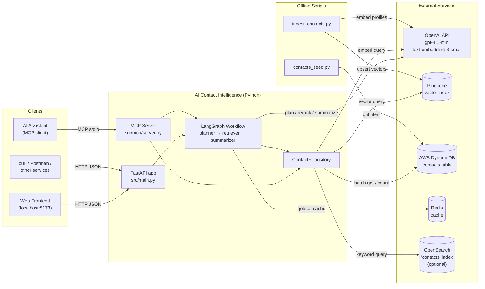

### 4.2 Deployment View (Local Development)

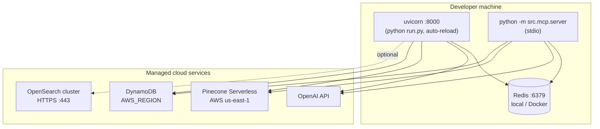

---

## 5. Code Architecture (Layers & Modules)

### 5.1 Layered View

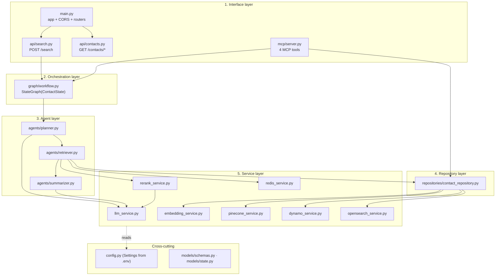

**Dependency rule:** each layer only calls the layer(s) below it. Agents never talk to the Pinecone/DynamoDB SDKs directly; they go through `ContactRepository` (exception: the retriever uses `redis_service` and `rerank_service` directly).

### 5.2 Directory Map

```text
ai-contact-intelligence/
├── run.py                        # Starts uvicorn (127.0.0.1:8000, reload=True)
├── requirements.txt              # Pinned runtime dependencies
├── pyproject.toml                # Package metadata (name, version, python>=3.11)
├── .env.example                  # Template for secrets (copy to .env)
├── scripts/
│   ├── contacts_seed.py          # 30 sample contacts + seed_contacts() → DynamoDB
│   └── ingest_contacts.py        # Embeds contacts → upserts vectors into Pinecone
├── src/
│   ├── main.py                   # FastAPI app, CORS, router registration, health check
│   ├── config.py                 # Settings class – reads env vars via python-dotenv
│   ├── api/
│   │   ├── search.py             # POST /search → runs LangGraph workflow
│   │   └── contacts.py           # GET /contacts/count, GET /contacts/{id} (placeholders)
│   ├── agents/
│   │   ├── planner.py            # LLM → JSON {intent, location, title, skills}
│   │   ├── retriever.py          # cache → hybrid search → rerank → DynamoDB → cache
│   │   └── summarizer.py         # LLM answer grounded in retrieved contacts
│   ├── graph/
│   │   └── workflow.py           # planner → retriever → summarizer, compiled graph
│   ├── mcp/
│   │   └── server.py             # FastMCP server exposing 4 tools
│   ├── models/
│   │   ├── schemas.py            # Pydantic request/response models
│   │   └── state.py              # ContactState TypedDict (graph state)
│   ├── repositories/
│   │   └── contact_repository.py # Hybrid search + contact lookups façade
│   ├── services/
│   │   ├── llm_service.py        # Chat completion (gpt-4.1-mini, temp 0)
│   │   ├── embedding_service.py  # Embeddings (text-embedding-3-small)
│   │   ├── rerank_service.py     # LLM-based reranking of contact IDs
│   │   ├── pinecone_service.py   # Lazy index creation, query, upsert
│   │   ├── dynamo_service.py     # get / batch_get / put / count
│   │   ├── redis_service.py      # JSON get/set with TTL
│   │   ├── opensearch_service.py # multi_match keyword search
│   │   └── contact_service.py    # Legacy simple Pinecone search (unused)
│   └── data/
│       └── contacts.py           # Empty placeholder
└── test/                         # Standalone experiments (not automated tests)
```

---

## 6. Data Model

### 6.1 The Contact entity

Every contact has the same five fields everywhere in the system:

| Field | Type | Example | Notes |
|---|---|---|---|
| `contactId` | string | `"1"` | Unique ID. DynamoDB partition key **and** Pinecone vector ID. |
| `name` | string | `"John Doe"` | |
| `title` | string | `"Frontend Engineer"` | Job title. |
| `location` | string | `"Bangalore"` | City. Used as an exact-match Pinecone filter. |
| `skills` | list[string] | `["React","TypeScript","AWS"]` | |

### 6.2 How a contact is stored in each system

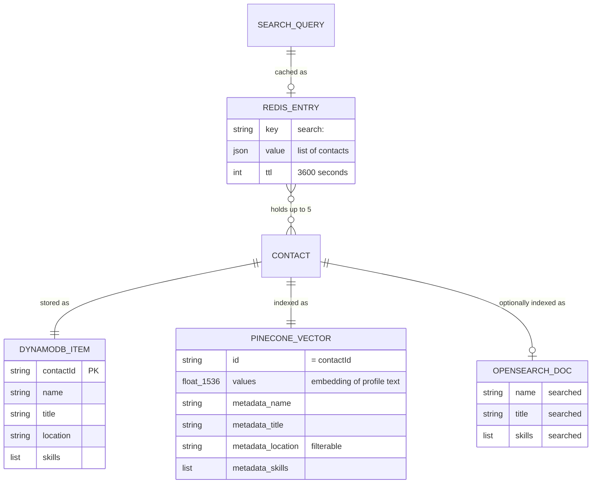

**Text that gets embedded for each contact** (`scripts/ingest_contacts.py → build_contact_text`):

```text
Name: John Doe
Title: Frontend Engineer
Location: Bangalore
Skills: React, TypeScript, AWS
```

### 6.3 Workflow state (`ContactState`)

This dictionary is passed from node to node in the LangGraph workflow. Each agent reads what it needs and returns an updated copy.

| Key | Type | Set by | Description |
|---|---|---|---|
| `query` | str | caller | The user's raw natural-language request. |
| `intent` | str | planner | e.g. `"search_contacts"`. |
| `filters` | dict | planner | Full plan: `{intent, location, title, skills}`. |
| `contacts` | list | retriever | Up to 5 ranked contact records. |
| `response` | str | summarizer | Final natural-language answer. |

### 6.4 API models (`src/models/schemas.py`)

| Model | Fields | Used |
|---|---|---|
| `SearchRequest` | `query: str` | Body of `POST /search`. |
| `SearchResponse` | `response: str`, `contacts: list` | Defined, not yet wired as `response_model`. |
| `ContactResponse` | `contactId, name, title, location, skills` | Defined, not yet used. |

### 6.5 Sample dataset

`scripts/contacts_seed.py` contains **30 sample contacts** (IDs `"1"`–`"30"`) spread across Indian cities (Bangalore, Hyderabad, Chennai, Mumbai, Delhi, Pune, Ahmedabad, …) with roles such as Frontend/Backend/Full-Stack Engineer, Cloud Architect, DevOps, Data Engineer/Scientist, and Product Designer.

---

## 7. Flow Diagrams

### 7.1 End-to-end search — sequence diagram

What happens when a client calls `POST /search` with `{"query": "Find React engineers in Bangalore"}`:

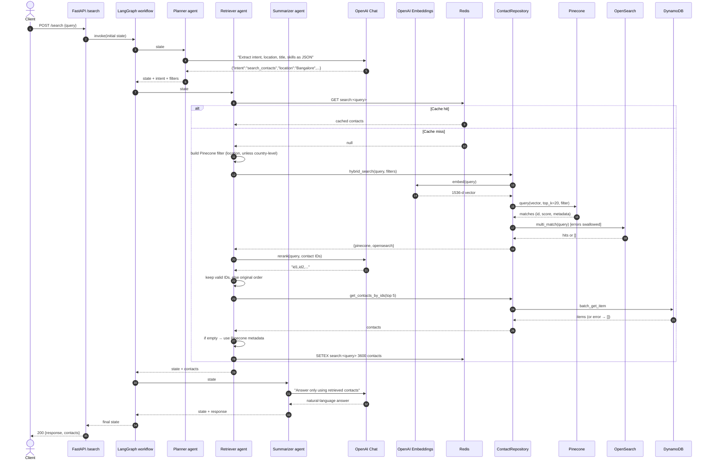

### 7.2 LangGraph workflow (state machine)

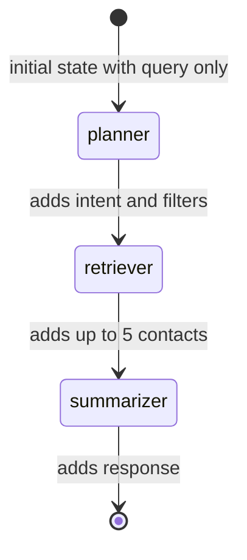

### 7.3 Planner agent — decision flow

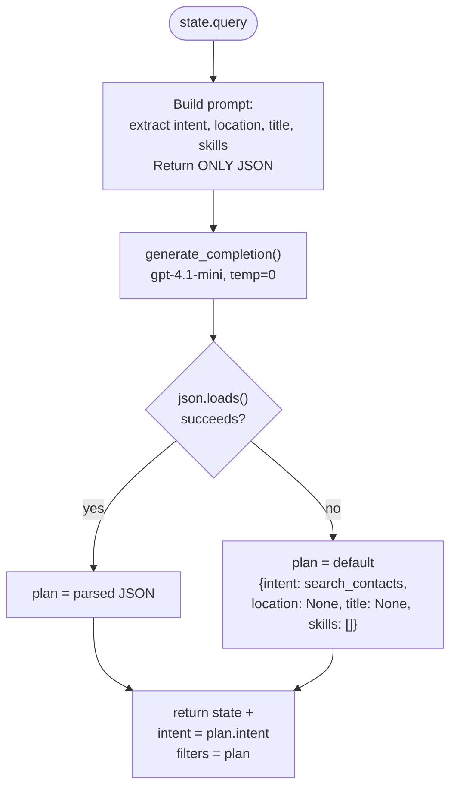

### 7.4 Retriever agent — decision flow

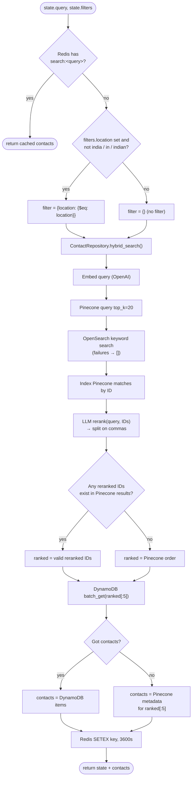

### 7.5 Summarizer agent

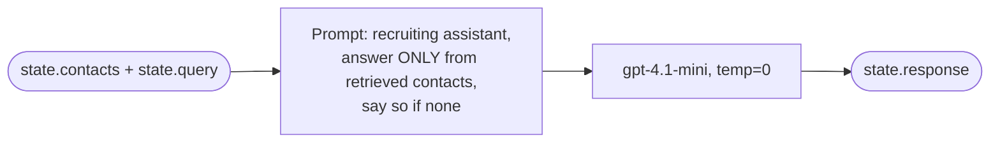

### 7.6 Data ingestion (offline) flow

Run once (and again after changing the seed data):

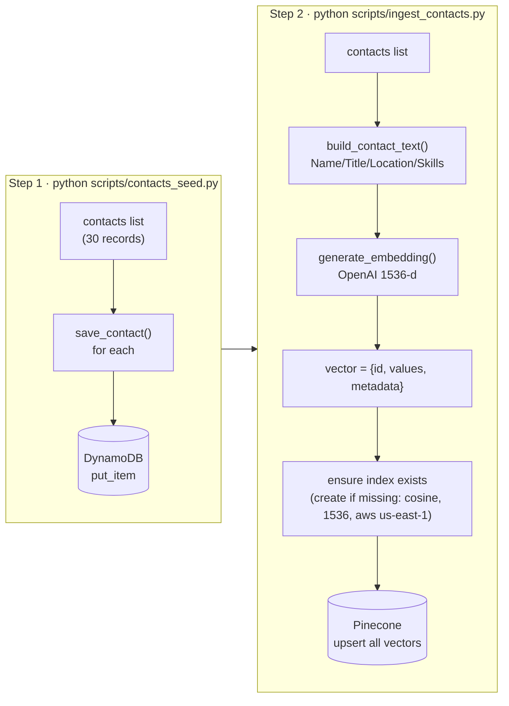

> **Note:** No script currently loads contacts into OpenSearch. If you want keyword search, you need to create and populate an OpenSearch index named `contacts` with `name`, `title`, `skills` fields yourself.

### 7.7 MCP tool call flow

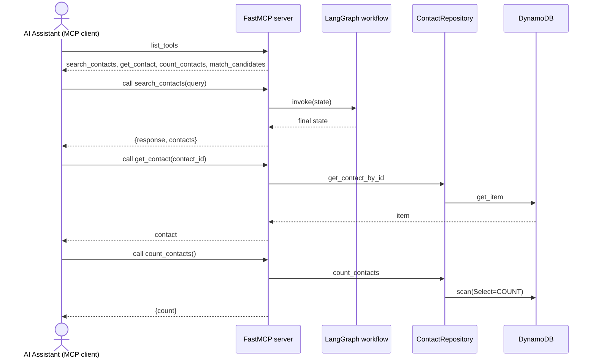

### 7.8 Application startup flow

Many clients are created **at import time**, so a misconfiguration fails at startup rather than per request:

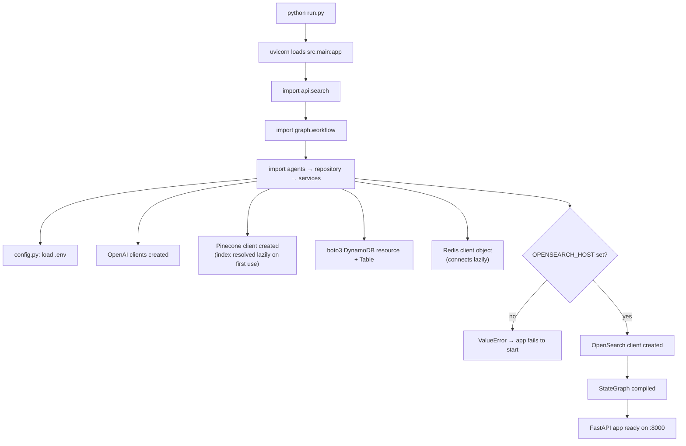

---

## 8. Component Reference

### 8.1 Interface layer

| File | What it does |
|---|---|
| `run.py` | Adds the project root to `sys.path` and starts uvicorn on `127.0.0.1:8000` with auto-reload watching `src/`. |
| `src/main.py` | Creates the FastAPI app (`title="AI Contact Intelligence"`), adds CORS for `http://localhost:5173`, mounts the `search` and `contacts` routers, defines `GET /` health check. |
| `src/api/search.py` | `POST /search`: validates `SearchRequest`, calls `workflow.invoke(...)` with an empty initial state, returns `response` + `contacts`. |
| `src/api/contacts.py` | `GET /contacts/count` and `GET /contacts/{contact_id}` — **placeholders** (return `0` / echo the ID). Real implementations exist in `ContactRepository`. |
| `src/mcp/server.py` | FastMCP server named `"Contact Intelligence"` exposing 4 tools (see [Section 10](#10-mcp-server-reference)). |

### 8.2 Orchestration — `src/graph/workflow.py`

Builds a `StateGraph(ContactState)` with three nodes and a linear path:

```text
entry → planner → retriever → summarizer → end
```

`workflow = graph.compile()` is a module-level singleton reused by both the API and MCP server.

### 8.3 Agents

| Agent | Input from state | Output to state | External calls |
|---|---|---|---|
| **Planner** (`planner_agent`) | `query` | `intent`, `filters` | 1 × LLM |
| **Retriever** (`retriever_agent`) | `query`, `filters` | `contacts` | Redis, OpenAI embeddings, Pinecone, OpenSearch, 1 × LLM (rerank), DynamoDB |
| **Summarizer** (`summarizer_agent`) | `query`, `contacts` | `response` | 1 × LLM |

Retriever helpers:

- `COUNTRY_LOCATIONS = {"india", "in", "indian"}` — broad locations that should **not** become a filter (all sample data is in India, so filtering on "India" would wrongly return nothing).
- `should_apply_location_filter(location)` — `True` only for non-empty, non-country locations.
- `contact_from_pinecone_match(match)` — converts a Pinecone match into the standard contact dict (used as fallback).

### 8.4 Repository — `ContactRepository`

| Method | Behaviour |
|---|---|
| `hybrid_search(query, filters)` | Embeds the query, queries Pinecone (top 20, with filter), tries OpenSearch (errors → `[]`), returns `{"pinecone": [...], "opensearch": [...]}`. |
| `get_contacts_by_ids(ids)` | DynamoDB `batch_get_item`; any error → `[]`. |
| `get_contact_by_id(id)` | DynamoDB `get_item`. |
| `count_contacts()` | DynamoDB `scan(Select="COUNT")`. |

### 8.5 Services

| Service | Key functions | Details |
|---|---|---|
| `llm_service` | `generate_completion(prompt)` | OpenAI Chat Completions, model `gpt-4.1-mini`, `temperature=0`, single user message. |
| `embedding_service` | `generate_embedding(text)` | OpenAI `text-embedding-3-small` → 1536 floats. |
| `rerank_service` | `rerank_results(query, ids)` | Asks the LLM to order the IDs; parses by removing newlines and splitting on `,`. |
| `pinecone_service` | `ensure_index_exists`, `get_index`, `semantic_search`, `upsert_contact`, `index` | Lazily creates the index if missing (cosine, 1536-d, serverless AWS us-east-1). `index` is a proxy object that resolves the real index on first attribute access. |
| `dynamo_service` | `get_contact`, `batch_get_contacts`, `save_contact`, `count_contacts` | Uses boto3 resource (`Table`) for get/put/scan and the low-level client for batch get. |
| `redis_service` | `get_cache`, `set_cache(ttl=3600)` | Stores values as JSON strings with `SETEX`. |
| `opensearch_service` | `build_host_config`, `keyword_search(query, size=20)` | `multi_match` on `name`, `title`, `skills` in index `contacts`; HTTPS with basic auth. |
| `contact_service` | `search_contacts(query)` | Older, simpler Pinecone-only search (top 5). Not used by the workflow. |

### 8.6 Configuration — `src/config.py`

A `Settings` class loads values from environment variables (and `.env` via `python-dotenv`). A single `settings` instance is imported by all services. See [Section 11](#11-configuration).

---

## 9. REST API Reference

Base URL (local): `http://127.0.0.1:8000` · Interactive docs: `http://127.0.0.1:8000/docs` (Swagger UI) and `/redoc`.

### `GET /` — Health check

```bash
curl http://127.0.0.1:8000/
```

```json
{ "status": "healthy" }
```

> This only confirms the web process is up; it does not check Pinecone/DynamoDB/Redis/OpenAI.

### `POST /search` — Natural-language contact search

**Request body**

| Field | Type | Required | Description |
|---|---|---|---|
| `query` | string | yes | Free-text request or job description. |

```bash
curl -X POST http://127.0.0.1:8000/search \
  -H "Content-Type: application/json" \
  -d '{"query":"Find backend engineers with Python and AWS"}'
```

**Response `200`**

```json
{
  "response": "Sarah Smith is a Backend Engineer in Hyderabad skilled in Python, FastAPI and AWS...",
  "contacts": [
    {
      "contactId": "2",
      "name": "Sarah Smith",
      "title": "Backend Engineer",
      "location": "Hyderabad",
      "skills": ["Python", "FastAPI", "AWS"]
    }
  ]
}
```

| Field | Description |
|---|---|
| `response` | LLM-written answer grounded in `contacts`. |
| `contacts` | Up to 5 contacts, most relevant first. |

**Errors:** `422` if `query` is missing/invalid (FastAPI validation). `500` if an unhandled upstream error occurs (e.g., Redis/OpenAI/Pinecone unreachable).

### `GET /contacts/count` *(placeholder)*

Currently always returns `{"count": 0}`.

### `GET /contacts/{contact_id}` *(placeholder)*

Currently returns `{"contactId": "<contact_id>"}` without a lookup.

---

## 10. MCP Server Reference

Start: `python -m src.mcp.server` (stdio transport by default).

| Tool | Arguments | Returns | Implementation |
|---|---|---|---|
| `search_contacts` | `query: str` | `{response, contacts}` | Full LangGraph workflow. |
| `get_contact` | `contact_id: str` | Contact item or `null` | DynamoDB `get_item`. |
| `count_contacts` | — | `{count}` | DynamoDB scan count. |
| `match_candidates` | `job_description: str` | Full workflow state `{query, intent, filters, contacts, response}` | Same workflow, job description used as the query. |

Example MCP client configuration (e.g., Claude Desktop `claude_desktop_config.json`):

```json
{
  "mcpServers": {
    "contact-intelligence": {
      "command": "/path/to/ai-contact-intelligence/venv/bin/python",
      "args": ["-m", "src.mcp.server"],
      "cwd": "/path/to/ai-contact-intelligence"
    }
  }
}
```

---

## 11. Configuration

All configuration comes from environment variables (put them in a `.env` file in the project root — it is git-ignored).

| Variable | Required? | Default | Used by | Purpose |
|---|---|---|---|---|
| `OPENAI_API_KEY` | **Yes** | — | LLM + embeddings | OpenAI authentication. |
| `PINECONE_API_KEY` | **Yes** | — | Pinecone | Pinecone authentication. |
| `PINECONE_INDEX_NAME` | **Yes** | — | Pinecone | Index name (auto-created if missing). |
| `AWS_REGION` | **Yes** | — | DynamoDB | e.g. `us-east-1`. |
| `DYNAMODB_TABLE_NAME` | **Yes** | — | DynamoDB | Table with partition key `contactId` (String). |
| `REDIS_HOST` | **Yes** | `None` (redis-py then uses `localhost`) | Redis | Cache host. |
| `REDIS_PORT` | No | `6379` | Redis | Cache port. |
| `OPENSEARCH_HOST` | **Must be set** (see note) | — | OpenSearch | `https://host[:port]` or bare host (port 443). |
| `OPENSEARCH_USERNAME` | Optional | — | OpenSearch | Basic auth user. |
| `OPENSEARCH_PASSWORD` | Optional | — | OpenSearch | Basic auth password. |

AWS credentials are picked up by boto3's standard chain (`~/.aws/credentials`, `AWS_ACCESS_KEY_ID`/`AWS_SECRET_ACCESS_KEY`, IAM role, …).

> **Note on OpenSearch:** search *calls* to OpenSearch are optional (failures are ignored), but the OpenSearch **client is constructed at import time** and raises `ValueError` if `OPENSEARCH_HOST` is empty. Set it to any value (even a placeholder URL) if you don't use OpenSearch.

Hard-coded settings worth knowing:

| Setting | Value | Location |
|---|---|---|
| Chat model | `gpt-4.1-mini`, temperature 0 | `llm_service.py` |
| Embedding model | `text-embedding-3-small` (1536-d) | `embedding_service.py`, `pinecone_service.py` |
| Pinecone metric / cloud | cosine, AWS `us-east-1` serverless | `pinecone_service.py` |
| Pinecone candidates | `top_k=20` | `pinecone_service.semantic_search` |
| Contacts returned | 5 | `retriever.py` |
| Cache TTL | 3600 s | `redis_service.set_cache` |
| OpenSearch index / size | `contacts`, 20 | `opensearch_service.py` |
| Server host/port | `127.0.0.1:8000` | `run.py` |
| CORS origin | `http://localhost:5173` | `main.py` |

---

## 12. Setup, Running & Deployment

### 12.1 Prerequisites

- Python 3.11+
- OpenAI account + API key
- Pinecone account + API key
- AWS account with a DynamoDB table (partition key `contactId`, type String) and credentials
- Redis (local install or Docker)
- *(Optional)* OpenSearch cluster

### 12.2 Step-by-step

```bash
# 1. Install
python -m venv venv
source venv/bin/activate
pip install -r requirements.txt          # or: pip install -e .

# 2. Configure
cp .env.example .env                     # then fill in ALL variables from Section 11

# 3. Start Redis (if not already running)
docker run -d --name redis -p 6379:6379 redis:7

# 4. Create the DynamoDB table (once)
aws dynamodb create-table \
  --table-name <your_contacts_table> \
  --attribute-definitions AttributeName=contactId,AttributeType=S \
  --key-schema AttributeName=contactId,KeyType=HASH \
  --billing-mode PAY_PER_REQUEST \
  --region <AWS_REGION>

# 5. Load data
python scripts/contacts_seed.py          # → DynamoDB
python scripts/ingest_contacts.py        # → Pinecone (creates index if needed)

# 6. Run the API
python run.py                            # http://127.0.0.1:8000  (docs at /docs)

# 7. (Optional) Run the MCP server
python -m src.mcp.server
```

### 12.3 Smoke test

```bash
curl http://127.0.0.1:8000/
curl -X POST http://127.0.0.1:8000/search \
  -H "Content-Type: application/json" \
  -d '{"query":"Find React engineers in Bangalore"}'
```

### 12.4 Production deployment notes

Not yet set up in the repo. A typical path would be:

- Run with `uvicorn src.main:app --host 0.0.0.0 --port 8000 --workers N` (no `--reload`) in a container.
- Use managed Redis (e.g., ElastiCache) and an IAM role for DynamoDB access.
- Store secrets in a secrets manager instead of `.env`.
- Update the CORS `allow_origins` list for the real front-end domain.

---

## 13. Error Handling & Failure Modes

| Situation | What happens today | User-visible effect |
|---|---|---|
| Planner LLM returns non-JSON (e.g., wrapped in ```` ```json ```` fences) | Caught → default plan (no filters) | Search still works, just without location filter. |
| Planner JSON lacks `intent` key | `KeyError` (not caught) | `500` error. |
| Location is "India"/"IN"/"Indian" | Filter skipped on purpose | Searches all locations. |
| OpenSearch unreachable / index missing | Caught → `[]` | None (results are Pinecone-only anyway). |
| `OPENSEARCH_HOST` not set | `ValueError` at import | **App fails to start.** |
| Rerank output unparseable | Falls back to Pinecone order | Results still returned. |
| DynamoDB batch get fails (or empty ID list) | Caught → `[]` → Pinecone metadata used | Results still returned (from Pinecone metadata). |
| Redis unreachable | Exception (not caught) | `500` error. |
| OpenAI / Pinecone unreachable or bad key | Exception (not caught) | `500` error. |
| No matching contacts | Empty list | Summarizer says no contacts found. |
| Missing `query` in request | FastAPI validation | `422` error. |

---

## 14. Known Limitations & Improvement Roadmap

These are observations from reading the current code, ordered roughly by impact.

### 14.1 Correctness issues

| # | Issue | Where | Suggested fix |
|---|---|---|---|
| 1 | **DynamoDB results come back in low-level typed format** (e.g. `{"name": {"S": "John"}}`), because `batch_get_contacts` uses `boto3.client` rather than the `Table` resource. The API therefore returns differently-shaped contacts depending on whether DynamoDB or the Pinecone fallback was used. | `dynamo_service.batch_get_contacts` | Use `dynamodb.batch_get_item` on the resource, or deserialize with `boto3.dynamodb.types.TypeDeserializer`. |
| 2 | **Rerank order is lost** — DynamoDB `batch_get_item` does not preserve key order. | `retriever_agent` | Re-sort DynamoDB items by `ranked_ids` after fetching. |
| 3 | **Reranker only sees IDs**, not names/titles/skills, so the LLM has nothing meaningful to rank on. | `rerank_service` | Pass the Pinecone metadata (name/title/location/skills) for each candidate. |
| 4 | **Rerank parsing doesn't strip whitespace**: `"1, 5, 3"` → `["1", " 5", " 3"]`; only `"1"` survives the validity filter, so results can shrink to a single contact. | `rerank_service` / `retriever_agent` | `[x.strip() for x in result.split(",")]`, or ask for a JSON array; append un-ranked IDs at the end. |
| 5 | **Location filter is exact and case-sensitive** (`$eq`). "bangalore" or "Bengaluru" won't match "Bangalore". | `retriever_agent` | Normalize stored + queried locations (lowercase, alias map). |
| 6 | **Title and skills from the planner are extracted but unused.** | `retriever_agent` | Add `skills: {"$in": [...]}` filters or use them in reranking. |
| 7 | **Planner `KeyError`** if JSON lacks `intent`; fenced JSON not handled. | `planner_agent` | Use `plan.get(...)`, strip code fences, or use OpenAI JSON mode / structured outputs. |
| 8 | **OpenSearch is required at import time** even though it's "optional". | `opensearch_service` | Create the client lazily (like Pinecone) and skip if host unset. |
| 9 | **OpenSearch results are fetched but never merged** into the ranking — "hybrid" search is currently Pinecone-only. | `retriever_agent` | Merge via Reciprocal Rank Fusion (RRF). |

### 14.2 Performance & robustness

| # | Issue | Suggested fix |
|---|---|---|
| 10 | `workflow.invoke` (synchronous, several network calls) runs inside an `async` endpoint, blocking the event loop. | Use `await workflow.ainvoke(...)` with async clients, or make the endpoint a plain `def` so FastAPI runs it in a thread pool. |
| 11 | Redis failure breaks search. | Wrap cache get/set in `try/except` and treat errors as a cache miss. |
| 12 | Cache key is the raw query (case/whitespace sensitive); the summarizer still calls the LLM on a cache hit. | Normalize the key; optionally cache the final response too. |
| 13 | `count_contacts` uses a single `scan` (max 1 MB per page) — undercounts large tables. | Paginate with `LastEvaluatedKey`, or use `describe_table` item count (approximate). |
| 14 | `batch_get_item` max 100 keys and may return `UnprocessedKeys`. | Handle retries (fine today since only 5 IDs are fetched). |
| 15 | Ingestion embeds contacts one at a time. | Batch embedding requests (the API accepts a list of inputs). |

### 14.3 Completeness

- `GET /contacts/count` and `GET /contacts/{id}` are placeholders — wire them to `ContactRepository` (the MCP server already does).
- `SearchResponse` / `ContactResponse` models are defined but not used as `response_model`.
- No OpenSearch ingestion script.
- No automated test suite (see [Section 15](#15-experimental-scripts-test)); no CI.
- No authentication, rate limiting, logging, or metrics.
- `.env.example` only lists 2 of the 10 variables.
- `src/services/contact_service.py` and `src/data/contacts.py` are unused.

### 14.4 Possible future features

- Conditional LangGraph edges (e.g., skip retrieval for non-search intents, retry with relaxed filters when 0 results).
- Streaming responses to the front-end.
- Contact CRUD endpoints with automatic re-embedding.
- Richer profiles (experience, seniority, email) and filters on them.

---

## 15. Experimental Scripts (`test/`)

The `test/` folder holds **standalone learning/experiment scripts**, not automated tests (there's no pytest suite). They talk to OpenAI/Pinecone directly and do **not** use the `src/` code.

| Script | Purpose |
|---|---|
| `llm_test.py` | Minimal OpenAI chat completion call. |
| `embeddings_test.py` | Embeds two phrases and prints their cosine similarity. |
| `embeddings_contact.py` | In-memory semantic search over a few contacts using NumPy. |
| `vector_database.py` | Upserts sample contacts into a Pinecone index. |
| `contacts_seed.py` | Seeds a richer `Contact` dataclass (role, email, experience) into Pinecone. |
| `rag.py` | Minimal RAG: retrieve from Pinecone, answer with the LLM. |
| `contact_search.py` | Earlier end-to-end search prototype. |

> ⚠️ These scripts use a hard-coded index `contacts-index` and in some cases **512-dimension** embeddings, which is **incompatible** with the main app's 1536-dimension index. Don't point them at the same index as the application.

---

## 16. Troubleshooting / FAQ

**The app crashes on startup with `ValueError: OPENSEARCH_HOST is not set`.**
Set `OPENSEARCH_HOST` in `.env` (any placeholder works if you don't use OpenSearch). See [Section 11](#11-configuration).

**`ValueError: PINECONE_INDEX_NAME is not set` on first search.**
Add `PINECONE_INDEX_NAME` to `.env`.

**`redis.exceptions.ConnectionError` / 500 on `/search`.**
Redis isn't running or `REDIS_HOST`/`REDIS_PORT` are wrong. Start Redis (`docker run -p 6379:6379 redis:7`).

**Search returns no contacts.**
- Did you run `scripts/ingest_contacts.py`? Pinecone must contain vectors.
- Did your query include a city spelled differently from the data (e.g., "Bengaluru" vs "Bangalore")? The location filter is exact.

**Contacts in the response look like `{"name": {"S": "..."}}`.**
That's the DynamoDB typed format — known issue #1 in [Section 14](#141-correctness-issues).

**I changed the seed data but results didn't change.**
Re-run both scripts, and clear Redis (`redis-cli FLUSHDB`) or wait 1 hour for cached queries to expire.

**`Dimension mismatch` errors from Pinecone.**
Your index was created with a different dimension (e.g., by the `test/` scripts at 512). Use a fresh index name for the app (1536).

**Where do I see the interactive API docs?**
`http://127.0.0.1:8000/docs`.

---

## 17. Glossary

| Term | Meaning |
|---|---|
| **Agent** | One step of the pipeline (planner, retriever, summarizer). |
| **BM25** | Classic keyword-relevance algorithm used by OpenSearch. |
| **Cosine similarity** | Measure of how close two vectors point in the same direction; Pinecone's metric here. |
| **CORS** | Browser rule controlling which websites may call the API. |
| **Embedding** | Numeric vector representing text meaning. |
| **FastMCP** | High-level helper in the MCP Python SDK for defining tools with decorators. |
| **Hybrid search** | Combining semantic (vector) and keyword search. |
| **LangGraph** | Library for building agent workflows as graphs over a shared state. |
| **MCP** | Model Context Protocol — standard for exposing tools to AI assistants. |
| **Metadata filter** | Constraint on stored fields (e.g., `location == "Bangalore"`) applied during a vector search. |
| **Partition key** | DynamoDB's primary lookup key (`contactId`). |
| **RAG** | Retrieval-Augmented Generation — retrieve facts, then generate an answer from them. |
| **Reranking** | Re-ordering retrieved candidates for better relevance. |
| **TTL** | Time-to-live; how long a cache entry lasts (3600 s here). |
| **Top-k** | Number of nearest results a vector search returns (20 here). |
